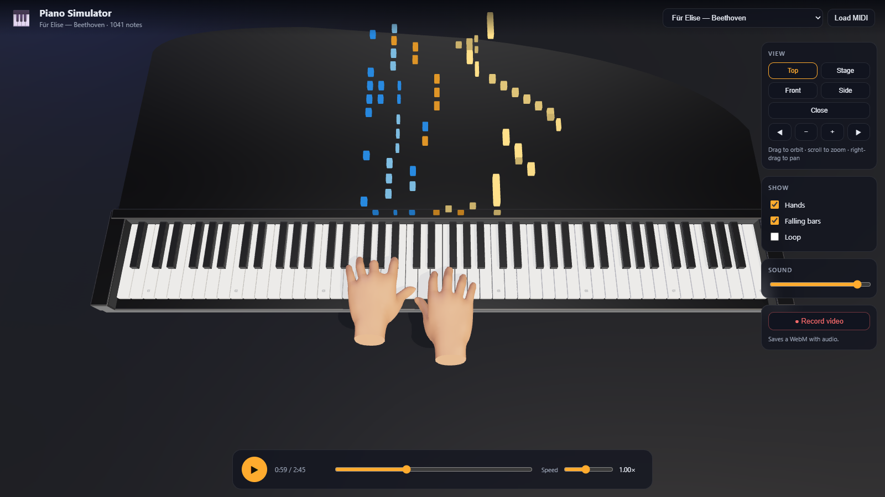
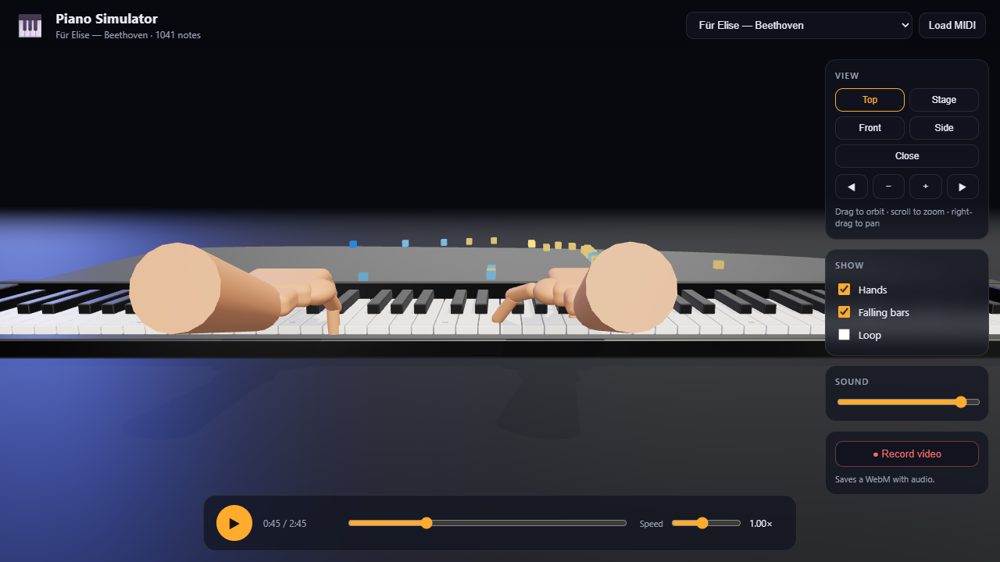
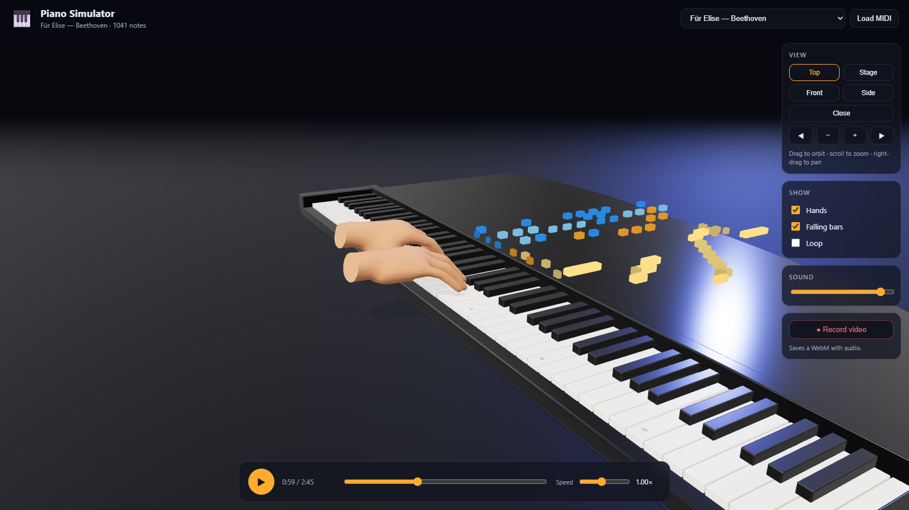
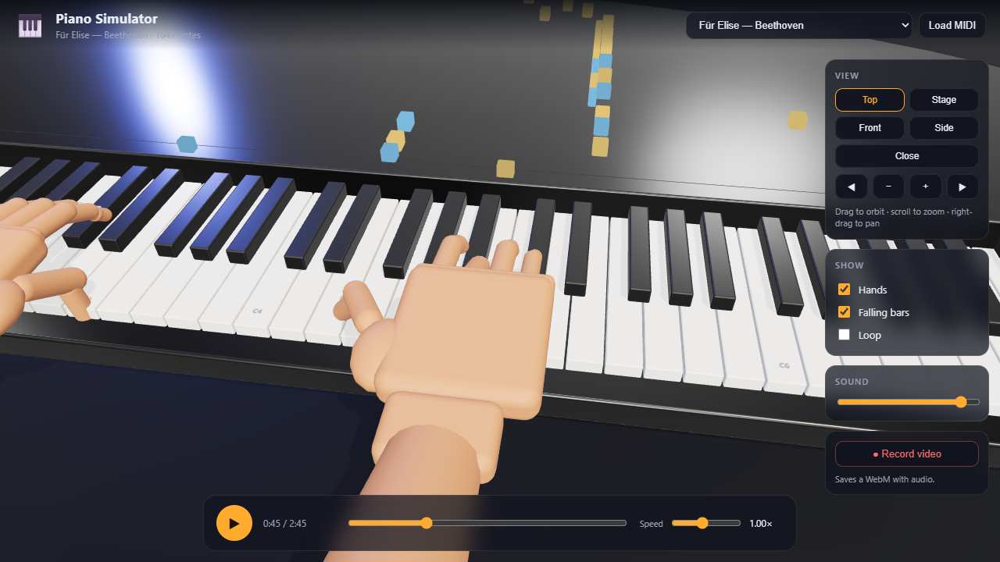

# Piano Simulator


A browser piano visualizer for practice and video recording. It loads a MIDI file, draws all 88 keys, and animates two hands that play the piece. Colored bars glide from far behind the piano toward the keys to show each note before it sounds. A sampled grand piano plays the audio.


## Features

### Full 88-key keyboard
The keyboard spans A0 to C8. It holds 52 white keys and 36 black keys. Each key uses the correct width and offset. A key dips when a note sounds and glows in the color of its hand. The case, nameboard, and grand rim frame the keys.

### Flowing note bars
Each note draws a bar that travels in depth. The bar starts on the grand rim far behind the keyboard and slides toward the keys. This far-to-near motion reads clearly from the default overhead view. The bar fades out just behind the keyboard, before it reaches the keys. The key glow marks the actual strike.

Bar width encodes note weight. Loud melody notes draw wide bars. Soft accompaniment notes draw thin bars. Width ranges from about 0.29 to 0.56 key units. Bar color encodes the hand. Blue bars belong to the left hand. Orange bars belong to the right hand.

### Piano pedals
A MIDI file can carry the piano pedals as control changes. CC64 is the damper pedal, CC66 the sostenuto pedal, and CC67 the soft pedal. The player reads these events, and the sheet draws each pedal that the file uses in its own lane beside the left end of the keyboard.

| Pedal | CC | Color | Effect |
|---|---|---|---|
| Damper (sustain) | 64 | Teal | A tone rings after its key lifts, until the pedal lifts. |
| Sostenuto | 66 | Violet | The pedal holds the tones that sound as it goes down. |
| Soft (una corda) | 67 | Amber | New tones start at 60% of their velocity. |

A span rides in with the note bars, so a pedal press reaches the strike line at the moment it sounds. A lane is empty until its pedal goes down. The transport shows the pedals that are down, for example `Pedal: damper`.

The player lifts every pedal at the end of a piece, so the last chord rings out and then stops. A piece with no pedal events shows no lane and no readout.

Fourteen of the 18 built-in pieces carry the damper pedal. Three of them also carry the soft pedal, and the Nutcracker Andante carries all three pedals. The other four pieces carry no pedal event at all. The soft pedal changes the level only. A sampler cannot move its hammers, so the tone does not darken.

### Two rigged hands
Each hand is a skinned mesh with 25 joints, the WebXR hand skeleton. The mesh comes from the `generic-hand` profile of the WebXR Input Profiles, which is the asset Three.js uses for hand tracking. A rig module poses the bones, and a contact solve places the wrist so the playing fingertips meet their keys.


The solve keeps the five fingers in their natural order. It measures each finger from the wrist, not from the world, so a wide chord cannot cross one finger over another. The playing fingers hold their keys, and the resting fingers spread between them. A relaxation pass then separates the finger shafts. It stops before it moves a playing finger off its key.

A finger fans at its knuckle, not across the palm. Each metacarpal holds its bind pose, so the palm keeps its width and the hand opens the way a real hand does. Only the thumb swings from its base joint, because its metacarpal sits free in the palm. The fan limit is 0.55 rad.

Each key has its own strike depth. A black key ends about 17 mm before the white strike line, so the solve aims a black-key finger at the black key. Each chord also gets a depth range, because the thumb reaches about 80 mm less far forward than the fingers.

The solve trims the curl of each finger until its tip meets its own key. It fans each finger at its knuckle to reach a wide chord, and it lifts the wrist when a chord lies beyond the reach of the hand. Between notes the resting fingers straighten and hover above the keys. On a strike they curl to the key surface. When the thumb still misses, the solve turns the palm about its forward axis, which dips the thumb side.

A fingering engine assigns the fingers. It groups notes into chords, splits them between the hands, and searches for a comfortable assignment. A beam search limits the hand span and prefers small shifts. The hand split follows the score rule that the lower staff is the left hand and the upper staff is the right hand, whatever the pitch: a track that names its hand, such as "Piano left", keeps all of its notes on that hand. Only a track with no name falls back to middle C. The layout, fingering, and rig modules import no Three.js, so you can test them in Node.

The original primitive hands remain as a fallback. Add `?hands=procedural` to the URL to use them, or `?hands=debug` to draw the skeletons.

### Selectable music
The menu lists 18 famous pieces. You can also load any standard MIDI file from your disk. The player parses the file, splits the notes between the hands, and marks the melody.

### Sampled audio
A Tone.js sampler plays the Salamander grand piano set. The set holds 30 samples across the range. A freeverb adds room tone. The browser needs one click before it can start audio.

### Camera and tempo
The default view looks straight down at the keyboard at 90°, so key widths and hand spans read at their true size. Five presets are available: top, perform, front, side, and close. The front, side, and close views slide along the keys with the player, so the hands stay in frame. A manual drag or pan releases the follow until you pick a preset again. OrbitControls lets you rotate, zoom, and pan left and right along the keys. The speed slider sets the tempo from 0.25x to 2x. A seek slider moves to any point. A loop toggle repeats the piece.

### Video recording
The recorder captures the canvas and the audio to a WebM file. It uses the browser MediaRecorder API at 60 frames per second. The file name records the shape, for example `piano-9x16-2026-11-18T09-12-44.webm`.

Choose a frame before the capture:

| Frame | Size | Use |
|---|---|---|
| 16:9 | 1920 by 1080 | Landscape video |
| 9:16 | 1080 by 1920 | Portrait video for a phone |

A click on a frame button shows that frame for 6 seconds. A dim scrim greys out the rest of the window, and the stage takes the shape of the video. The preview ends after 6 seconds, or as soon as a recording starts. The stage then holds the shape for the whole capture.

The frame changes the shape of the stage, and nothing else. The camera stays where you put it, so a zoom, a pan, or an orbit survives a frame change. In a portrait frame the stage shows a narrow crop of the same view.

A recording stops by itself when the piece ends. It keeps rolling for 2 seconds after the last note, so the final chord and its room tone stay in the file. Press Stop to end a recording early. The loop toggle cancels the automatic stop, because a looped piece never ends.

## Screenshots

All images show the first piece at about 59 seconds. Both hands play a three-note chord at that moment.

| View | Image |
|---|---|
| Top (default) |  |
| Perform |  |
| Front |  |
| Side |  |
| Close (hands) |  |
| Hands on the keys |  |
| Hands from a low angle |  |

## Stack

| Library | Version | Role |
|---|---|---|
| [Three.js](https://threejs.org/) | 0.187.0 | 3D rendering, materials, and controls |
| [Tone.js](https://tonejs.github.io/) | 15.1.22 | Audio sampler, reverb, and transport |
| [@tonejs/midi](https://github.com/Tonejs/Midi) | 2.0.28 | MIDI parsing |
| [Vite](https://vite.dev/) | 7 | Dev server and static build |

The renderer uses ACES filmic tone mapping and soft shadows. The hand material uses `MeshPhysicalMaterial` with sheen to approximate skin. The build output is about 299 kB gzipped.

## Quick start

```bash
npm install
npm run dev
```

Open http://localhost:5173. The first piece loads automatically. Click Play to start.

To build the static site:

```bash
npm run build
npm run preview
```

## Controls

| Control | Action |
|---|---|
| Piece menu | Select one of 18 built-in pieces. |
| Load MIDI | Open any standard MIDI file from your disk. |
| Play / Pause | Start or stop the performance. |
| Seek slider | Move to any point in the piece. |
| Speed slider | Set the tempo from 0.25x to 2x. |
| Loop | Repeat the piece when it ends. |
| Pedal lane | Show or hide the pedal lanes. Press P to toggle them. |
| View buttons | Switch between top, perform, front, side, and close views. |
| Mouse drag | Rotate the camera. |
| Mouse wheel | Zoom in and out. |
| Right drag | Move the view left and right along the keys. |
| Frame buttons (16:9, 9:16) | Set the shape of the video. The stage shows the frame for 6 seconds. |
| Record | Save a WebM video with audio. The recording stops when the piece ends. |
| `?hands=procedural` | Use the primitive hands instead of the rigged mesh. |
| `?hands=debug` | Draw the hand skeletons over the mesh. |

## Architecture

The code separates pure logic from rendering. You can test the logic in Node without a browser.

| File | Role |
|---|---|
| `src/layout.js` | Key geometry for all 88 keys. No Three.js import. |
| `src/fingering.js` | Hand split, chord grouping, and finger assignment. No Three.js import. |
| `src/scene.js` | Renderer, lights, camera presets, and OrbitControls. |
| `src/piano.js` | The keyboard, the keys, and the press animation. |
| `src/bars.js` | The depth-travelling note bars and the pedal lanes. |
| `src/pedals.js` | Pedal parsing, the hold state, and the lane geometry. No Three.js import. |
| `src/hands.js` | The hand models and the motion controller. |
| `src/handprocedural.js` | The primitive fallback hands, built from capsules and boxes. |
| `src/handrig.js` | Rig math: bind-pose calibration, finger pose, and key contact. No Three.js import. |
| `src/player.js` | MIDI parsing, the Tone.js sampler, and the transport. |
| `src/frames.js` | The two recording shapes and the fit maths. No Three.js import. |
| `src/recorder.js` | Canvas and audio capture to WebM. |
| `src/framepreview.js` | The timed frame preview and its scrim. |
| `src/songs.js` | The built-in piece catalog. |
| `src/main.js` | App wiring and UI events. |

## Tests

```bash
npm test
```

`npm test` runs six unit suites and the smoke test. The rig test checks the hand calibration, finger proportions, knuckle fan, and key contact against the bind pose in `tests/fixtures/`. The frames test checks the two video shapes and the fit maths. The key-light and chord tests check the key glow and the chord window. The fingering test checks the hand split against the staff rule, including a left-hand octave that sounds with the right hand. The pedal test checks the three control numbers, the span parsing, and the hold rule of each pedal. The smoke test checks the key layout, reads the pedal spans of all 18 MIDIs, and runs the fingering engine on all 18 MIDIs. It asserts that no hand span exceeds 19 semitones. All 18 pieces pass.

Regenerate the rig fixtures after changing an asset:

```bash
npm run fixtures
```

## Assets and sources

- MIDI files: `public/midi/`, from the `zz85/midiviz` repository (gh-pages branch).
- Three files exercise every pedal lane: `bach_wtc1_04.mid`, `bach_wtc2_06.mid`, and `tchai_nutcracker.mid`. They came from the same archive, which holds live competition recordings with damper, sostenuto, and soft pedal events.
- Piano samples: `public/samples/piano/`, the Salamander grand piano set from tonejs.github.io.
- Hand meshes: `public/hands/`, the `generic-hand` profile of the WebXR Input Profiles, MIT licence, copyright 2019 Amazon. See `docs/hands-assets.md`.
- The pieces are public-domain compositions. The MIDI renditions and samples belong to their respective authors.

## Limitations

- A few orchestral-reduction MIDIs contain chords wider than two hands can span. The engine stretches the hands to reach them. These chords look extended.
- A MIDI track with no name in its title carries no staff evidence, so its notes split at middle C, chord by chord. A single-track file whose left-hand figure crosses middle C therefore changes hand more often than the score does. A track name such as "Piano left" or "Left hand" removes this limit.
- The rig cannot reach every chord with one curl set. About 11% of chords land more than 5 mm from their keys, and the worst land 56 mm away. The contact solve reports that gap rather than bending the hand further. A fan at the knuckle keeps the palm rigid, so it reaches less far than a metacarpal swing would.
- The rig hand spans about 158 mm, against about 193 mm for an adult hand. All 16 right-hand tenth stretches therefore miss their keys by more than 10 mm.
- The resting thumb dips up to 7 mm below the key top on some pinky-only chords. The wrist cannot rise further without lifting the playing pinky off its key.
- Skin is a single material with no texture maps. The mesh carries no nails, pores, or creases.
- Recording uses the browser MediaRecorder API. Output is WebM. Some browsers may record video only if the audio tap is unavailable.