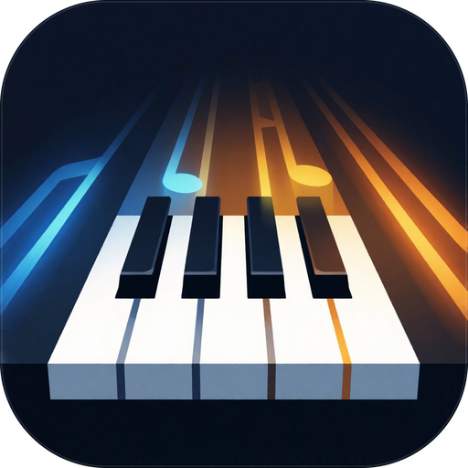
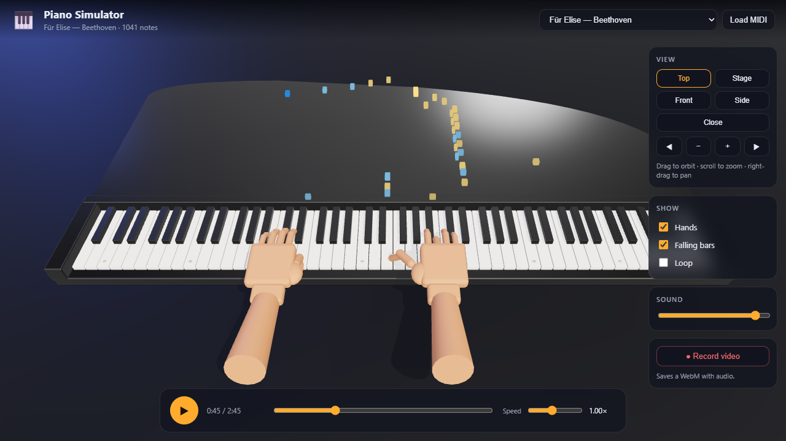
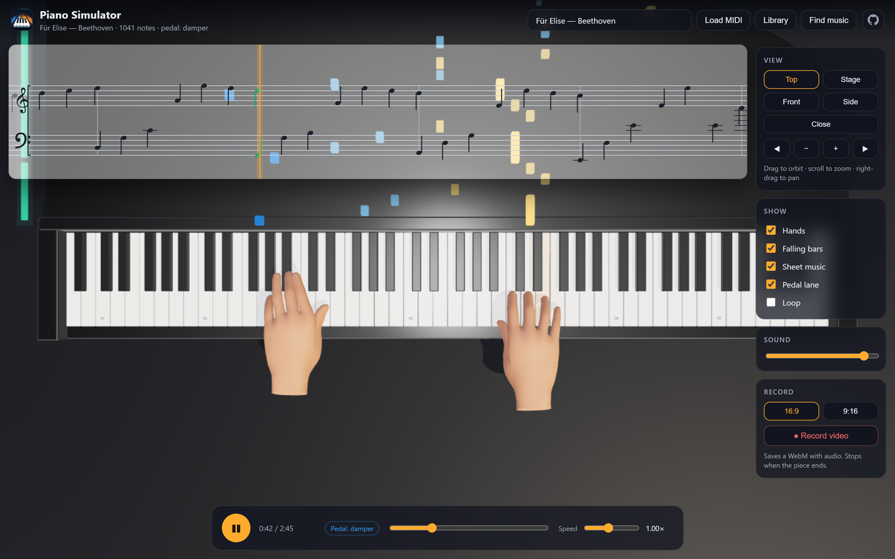
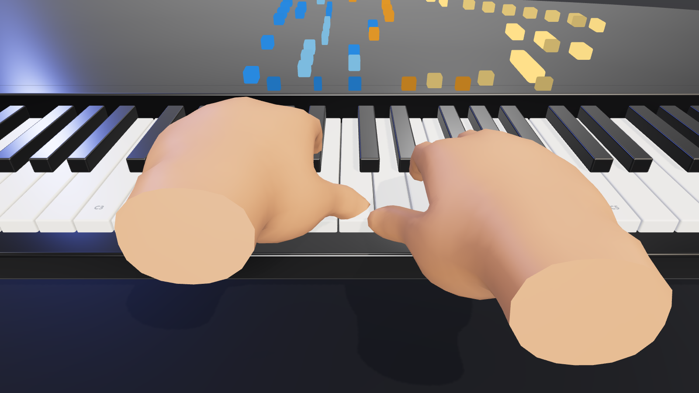
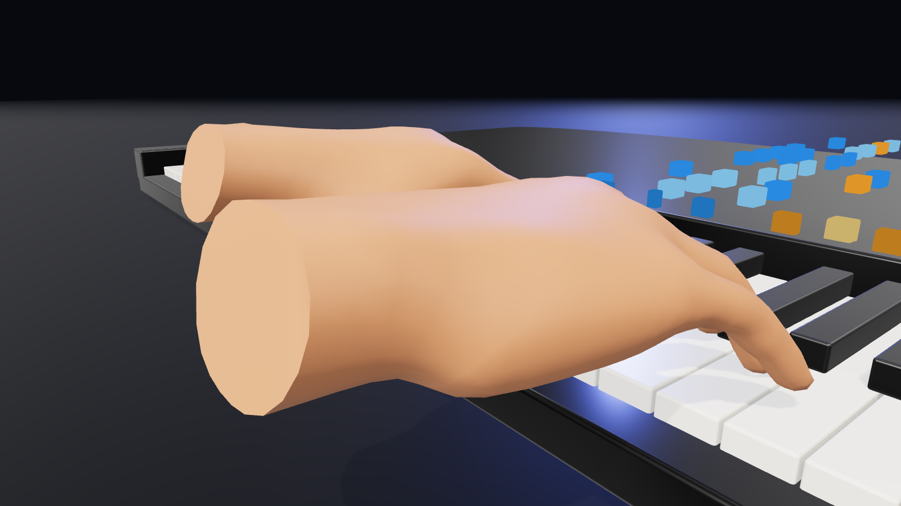
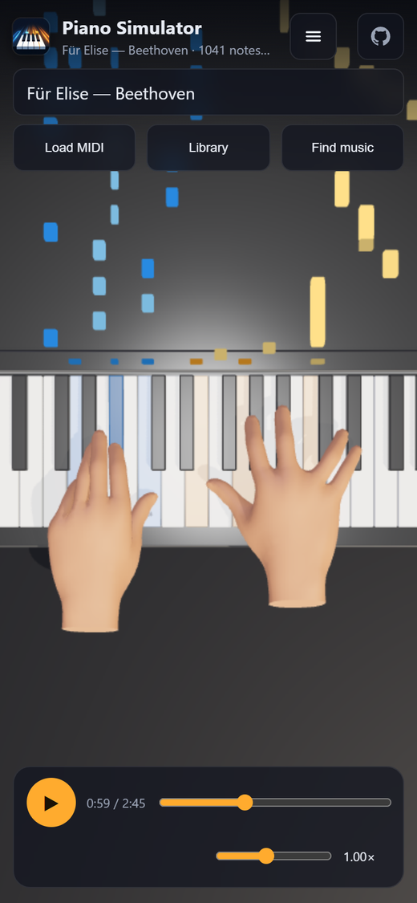
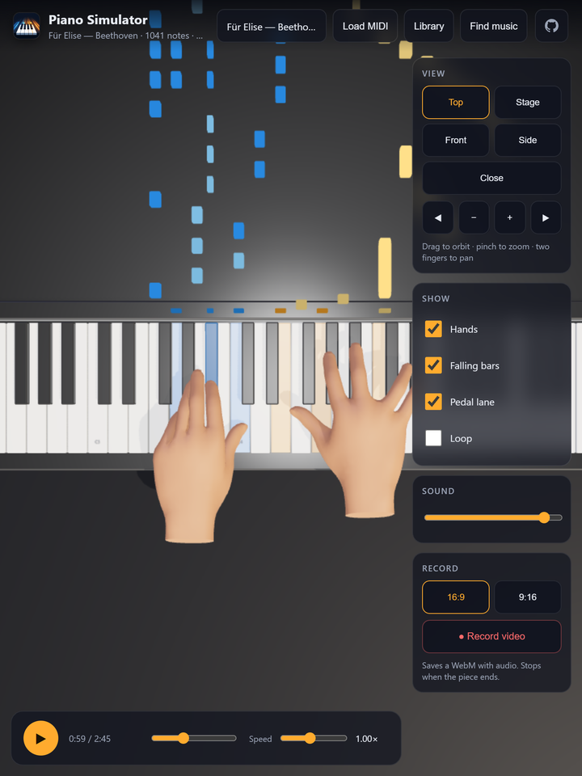

# Piano Simulator



A browser piano visualizer for practice and video recording. It loads a MIDI file, draws all 88 keys, and animates two hands that play the piece. Colored bars glide from far behind the piano toward the keys to show each note before it sounds. A sampled grand piano plays the audio.



## Features

### Full 88-key keyboard
The keyboard spans A0 to C8. It holds 52 white keys and 36 black keys. Each key uses the correct width and offset. A key dips when a note sounds and glows in the color of its hand. The case, nameboard, and grand rim frame the keys.

### Flowing note bars
Each note draws a bar that travels in depth. The bar starts on the grand rim far behind the keyboard and slides toward the keys. This far-to-near motion reads clearly from the default overhead view. The bar fades out just behind the keyboard, before it reaches the keys. The key glow marks the actual strike.

The bar holds the length of its own note, so a long note draws a long bar. It stops at the next note on the same key, so two bars never cover each other. A bar is 3.2 world units long for each second of its note. A note shorter than about 37 ms draws a 0.12-unit sliver, so the strike stays visible.

Bar width encodes note weight. Loud melody notes draw wide bars. Soft accompaniment notes draw thin bars. Width ranges from about 0.29 to 0.56 key units. Bar color encodes the hand. Blue bars belong to the left hand. Orange bars belong to the right hand.

### Piano pedals
A MIDI file can carry the piano pedals as control changes. CC64 is the damper pedal, CC66 the sostenuto pedal, and CC67 the soft pedal. The player reads these events, and the sheet draws each pedal that the file uses in its own lane beside the left end of the keyboard.

| Pedal | CC | Color | Effect |
|---|---|---|---|
| Damper (sustain) | 64 | Teal | A tone rings after its key lifts, until the pedal lifts. |
| Sostenuto | 66 | Violet | The pedal holds the tones that sound as it goes down. |
| Soft (una corda) | 67 | Amber | New tones start at 60% of their velocity. |

A span rides in with the note bars, so a pedal press reaches the strike line at the moment it sounds. A lane is empty until its pedal goes down. The transport shows the pedals that are down, for example `Pedal: damper`.

The player lifts every pedal at the end of a piece, so the last chord rings out and then stops. A piece with no pedal events shows no lane and no readout.

Fifteen of the 18 built-in pieces carry the damper pedal. Three of them also carry the soft pedal, and the Nutcracker Andante carries all three pedals. The other three pieces carry no pedal event at all. The soft pedal changes the level only. A sampler cannot move its hammers, so the tone does not darken.

### Sheet music
A translucent white band sits over the top of the stage and scrolls the piece past a fixed amber marker. The band is 60% transparent, so the falling note bars stay visible behind it. The right hand takes the upper staff and the left hand takes the lower staff. A note outside its staff draws ledger lines. A note that sounds turns green.

The band writes the symbols that a printed piano score uses. Each note takes the notehead of its value: a solid head for a quarter note or a shorter note, and a hollow head for a half note or a whole note. A whole note carries no stem. An eighth note carries one flag and a sixteenth note carries two. Notes that fall in one beat join under a beamed line, so a run of short notes reads as a group. A dotted value puts one dot in the space beside its head.

A beat with no note on a staff takes a rest. Two silent beats share a half rest, and a bar with no note takes a whole rest. A note still sounding fills its beat, so it takes no rest. The time signature sits beside the clefs and follows a change of signature.

The key signature sits between the clef and the time signature, and it follows a key change. Each note takes its letter and its sign from the key. A note that the key covers carries no accidental. A note that cancels a mark of the key carries a natural sign. A note outside the key carries a sharp or a flat, and the key decides which one.

The key-signature event of the MIDI file sets the marks. Six of the 18 built-in pieces carry no such event. For those pieces the band prints the signature that covers most of the sounding notes, and it charges one mark for each added sign. A piece in C major therefore keeps an empty signature.

The notes stop at the system line. No note scrolls under the clef, the key signature or the time signature, so the marks keep a clear column at the left margin of the paper.

Every mark takes its place from the staff. A notehead sits on its line or space. A stem starts on the head it belongs to and ends on a fixed length, or on the beam. A beam runs from the first stem to the last, and the stems of the group take one direction from the average pitch. A whole rest hangs from the fourth line and a half rest sits on the middle line. The digits of the time signature fill the two spaces beside the middle line, and a clef centres on the middle line of its own staff.

Bar lines come from the time signature and the tempo map of the file, so the bars follow a tempo change. The line spacing shrinks when the register is wide, so no note leaves the paper. The scroll speed follows the note density, so a fast passage keeps its notes apart. The band takes about a third of the window, and the stage sits below it.

The note value comes from the length the file gives, rounded to the sixteenth grid. A note held past the next onset on its staff stops at that onset, because the band draws no tie.

**Sheet music** in the Show section hides the paper, and the `M` key does the same. The paper shows at start.

The paper is an HTML layer, not part of the WebGL scene. A recording captures the canvas only, so the paper hides while a capture runs and the file shows the stage alone.



### Two rigged hands
Each hand is a skinned mesh with 25 joints, the WebXR hand skeleton. The mesh comes from the `generic-hand` profile of the WebXR Input Profiles, which is the asset Three.js uses for hand tracking. A rig module poses the bones, and a contact solve places the wrist so the playing fingertips meet their keys.



The solve keeps the five fingers in their natural order. It measures each finger from the wrist, not from the world, so a wide chord cannot cross one finger over another. The playing fingers hold their keys, and the resting fingers spread between them. A relaxation pass then separates the finger shafts. It stops before it moves a playing finger off its key.

A finger fans at its knuckle, not across the palm. Each metacarpal holds its bind pose, so the palm keeps its width and the hand opens the way a real hand does. Only the thumb swings from its base joint, because its metacarpal sits free in the palm. The fan limit is 0.55 rad.

Each key has its own strike depth. A black key ends about 17 mm before the white strike line, so the solve aims a black-key finger at the black key. Each chord also gets a depth range, because the thumb reaches about 80 mm less far forward than the fingers.

A hand also travels between chords instead of teleporting. Each chord gets a window in song time, sized from the distance the wrist covers and bounded by the gap since the previous chord, because a finger that still holds its key must not be dragged off it. Across that window the fingers fan and the palm rolls, with an ease that starts and ends at rest. The window closes on the note, so the spread the solve placed is the spread the strike uses, and a seek lands mid-travel instead of snapping to the chord. Measured over two 20-second runs of Für Elise, the largest single-frame change to a finger's spread fell from 31° to 12°.

The solve trims the curl of each finger until its tip meets its own key. It fans each finger at its knuckle to reach a wide chord, and it lifts the wrist when a chord lies beyond the reach of the hand. Between notes the resting fingers straighten and hover above the keys. On a strike they curl to the key surface. When the thumb still misses, the solve turns the palm about its forward axis, which dips the thumb side.

A fingering engine assigns the fingers. It groups notes into chords, splits them between the hands, and searches for a comfortable assignment. A beam search limits the hand span and prefers small shifts. The hand split follows the score rule that the lower staff is the left hand and the upper staff is the right hand, whatever the pitch: a track that names its hand, such as "Piano left", keeps all of its notes on that hand. Only a track with no name falls back to middle C. The layout, fingering, and rig modules import no Three.js, so you can test them in Node.

The original primitive hands remain as a fallback. Add `?hands=procedural` to the URL to use them, or `?hands=debug` to draw the skeletons.

### Selectable music
The picker lists 18 famous pieces. You can also load any standard MIDI file from your disk. The player parses the file, splits the notes between the hands, and marks the melody.

The picker is a searchable combobox. Type part of a title or a composer to filter the list. Matching ignores case and accents, so `fur elise` finds Für Elise and `pathetique` finds Pathétique. A query with more than one word needs every word to match, so `chopin nocturne` narrows the list rather than widening it. A title match ranks above a composer match, and a match at the start of the title ranks above a match in the middle. The matched text is marked in the list.

The keyboard drives the picker: the arrow keys move through the list, Home and End jump to either end, Enter loads the highlighted piece, and Escape closes the list and restores the current piece. Selecting the piece that is already loaded restarts it from the beginning.

No keyboard shortcut fires while the picker has focus, so Space, `L`, `P`, `R` and `1`–`5` type into the search field instead of changing the view or the transport.

### My MIDI files

**Load MIDI** keeps every imported file in a local library. A stored file stays in the picker after a reload, and the picker lists it under **My MIDI files**.

The bytes live in IndexedDB, keyed by the SHA-256 hash of the file. An import of the same bytes selects the stored copy instead of adding a duplicate. Nothing is uploaded to a server.

The **Library** button lists the stored files. Each row shows the size, the note count and the last played date. A row offers Load, Rename and Delete. Delete needs a second click. A rename sets the title and the composer, and the picker shows the new name.

- The app asks the browser to keep the library on the first import. The browser may refuse.
- A full storage quota shows a message and keeps the stored files. The imported file still plays.
- A private window may clear the library when it closes. A browser under storage pressure may also clear it.

### Finding music online

**Find music** searches the Internet Archive for MIDI files. Each result shows its source, its size and its licence before you load it. A result offers Load, Save and a link to the item page.

Save keeps the file in the local library, so it joins **My MIDI files**. Load plays it once without keeping it.

- A result is only shown when the item really holds a MIDI file. The app checks the item metadata before it lists the result.
- The licence comes from the item record. An item with no licence reads `Licence not stated`, and the item page is one click away.
- A provider that times out or fails leaves the rest of the list intact and reports the failure. Your own files keep working.
- Typing is debounced by 300 ms, and a new query cancels the old one.

The Internet Archive allows a browser to call its search API, but not its file download. A small Worker route, `/api/midi`, adds the missing CORS header. The route accepts only `https` downloads from `archive.org` or its storage hosts, refuses a foreign origin, caps a file at 8 MB, caches a download for a day, and limits each client to 60 requests a minute. A development server runs the same handler as middleware, so the feature works without a deploy.

### Sampled audio
A Tone.js sampler plays the Salamander grand piano set. The set holds 30 samples across the range. A freeverb adds room tone. The browser needs one click before it can start audio.

### Playback that survives a hidden tab
The piece keeps its own time. The player reads the time from the audio clock, which the browser runs for the sound it plays. A frame that arrives late, or not at all, therefore cannot slow the piece. The notes are placed on that clock two seconds ahead, so the rhythm holds while the page draws no frames. A background tab, a minimised window, or a locked phone continues to play. Only the transport controls stop or slow the piece.

### Camera and tempo
The default view looks straight down at the keyboard at 90°, so key widths and hand spans read at their true size. The stage sits a little below the centre of the window, and the sheet band takes the space above it. Five presets are available: top, perform, front, side, and close. The front, side, and close views slide along the keys with the player, so the hands stay in frame.

A drag, a wheel zoom, or a pan holds the view that you reach. A preset button resets the pan, the tilt, and the zoom. A manual change also releases the follow until you pick a preset again. OrbitControls handles the drag, the wheel zoom, and the right-drag pan. Two circle arrows beside the zoom buttons turn the view angle about the vertical axis. They keep the distance and the target, so the picture turns and does not shift. The speed slider sets the tempo from 0.25x to 2x. A seek slider moves to any point. A loop toggle repeats the piece.

### Video recording
The recorder captures the canvas and the audio to a WebM file. It uses the browser MediaRecorder API at 60 frames per second. The file name records the shape, for example `piano-9x16-2026-11-18T09-12-44.webm`.

Choose a frame before the capture:

| Frame | Size | Use |
|---|---|---|
| 16:9 | 1920 by 1080 | Landscape video |
| 9:16 | 1080 by 1920 | Portrait video for a phone |

A click on a frame button shows that frame for 6 seconds. A dim scrim greys out the rest of the window, and the stage takes the shape of the video. The preview ends after 6 seconds, or as soon as a recording starts. The stage then holds the shape for the whole capture.

When the piece ends, the recording stops by itself. A click on Record starts the audio context, so the file carries sound whether you press Play first or last. A capture made with no gesture at all, such as one started from a script, holds video with no audio and says so in the console.

This app does not stream. For a live performance, use a third-party tool that captures the window or the screen, such as OBS Studio. Point that tool at the platform ingest.

The frame changes the shape of the stage, and nothing else. The camera stays where you put it, so a zoom, a pan, or an orbit survives a frame change. In a portrait frame the stage shows a narrow crop of the same view: about 21 of the 52 key widths from the top view.

A capture holds the keys in its frame. While a recording runs, the camera pulls back along its own view direction until every key under the hands sits inside the frame, and it returns to your view when the music no longer needs the wider shot. It never zooms in past the view you chose, and it keeps the target and the angle, so the picture grows smaller and does not drift.

The view holds still for most of a take. It widens only when a note that needs more room is three seconds away, and it comes back in only when nothing in the next ten seconds needs the wider view, with a second of agreement and a three percent margin before it moves. A passage that repeats one chord therefore keeps one frame. Measured on Für Elise in a 9:16 frame, the camera changed its mind six times in 51 seconds, and 99% of frames held the same view.

A 16:9 frame holds the whole keyboard from the default view, so a landscape capture usually never moves the camera. The 9:16 frame is the one that needs the pull-back. The fog range follows the camera distance, so a pulled-back view keeps the piano as clear as the default one.

A recording stops by itself when the piece ends. It keeps rolling for 2 seconds after the last note, so the final chord and its room tone stay in the file. Press Stop to end a recording early. The loop toggle cancels the automatic stop, because a looped piece never ends.

## Screenshots

All images show the first piece at about 59 seconds. Both hands play a three-note chord at that moment.

| View | Image |
|---|---|
| Top (default) |  |
| Perform |  |
| Front |  |
| Side |  |
| Close (hands) |  |
| Hands on the keys |  |
| Hands from a low angle |  |

### Phone and tablet

| Phone, 390 by 844 | Tablet, 768 by 1024 |
|---|---|
|  |  |

On a phone the header takes three rows and the transport takes two, so the seek bar keeps a width of its own. On a tablet the panel stays in the right corner, and every control takes a 44px target.

## Stack

| Library | Version | Role |
|---|---|---|
| [Three.js](https://threejs.org/) | 0.187.0 | 3D rendering, materials, and controls |
| [Tone.js](https://tonejs.github.io/) | 15.1.22 | Audio sampler, reverb, and transport |
| [@tonejs/midi](https://github.com/Tonejs/Midi) | 2.0.28 | MIDI parsing |
| [Vite](https://vite.dev/) | 7 | Dev server and static build |

The renderer uses ACES filmic tone mapping and soft shadows. The hand material uses `MeshPhysicalMaterial` with sheen to approximate skin. The build output is about 299 kB gzipped.

## Quick start

```bash
npm install
npm run dev
```

Open http://localhost:5173. The first piece loads automatically. Click Play to start.

To build the static site:

```bash
npm run build
npm run preview
```

## Deploy

The site is a Worker with one script. `wrangler.jsonc` publishes `dist/` as assets, and `worker/index.js` answers `/api/midi` for the remote search. Every other request reaches the assets, so the build output is still the whole site.

```bash
npm run deploy
```

That runs the build and then `wrangler deploy`, which pushes to https://piano-simulator.fuleinist.workers.dev. The first local deploy needs `wrangler login`.

`main` deploys itself. `.github/workflows/deploy.yml` runs on every push to `main` and on a manual dispatch: it installs from `package-lock.json`, runs `npm test`, builds, and deploys, so the live site always matches the branch. A push that fails a test never reaches the site.

The workflow needs two repository secrets. Create the token in the Cloudflare dashboard under **Account API tokens → Create Token → Edit Cloudflare Workers**, then store both values in GitHub:

| Secret | Value |
|---|---|
| `CLOUDFLARE_API_TOKEN` | The API token from the step above. |
| `CLOUDFLARE_ACCOUNT_ID` | The account ID, `e4b284aa77c8190001b991f21e15df11`. |

Add them with `gh secret set CLOUDFLARE_API_TOKEN` and `gh secret set CLOUDFLARE_ACCOUNT_ID`, or under **Settings → Secrets and variables → Actions**. Without them the deploy step fails at authentication, and the step log says which one is missing.

`npm run deploy` needs no token: it uses the local `wrangler` session.

## Controls

| Control | Action |
|---|---|
| Piece picker | Search the 18 built-in pieces by title or composer, then pick one. |
| Load MIDI | Open any standard MIDI file from your disk. The file stays in the library. |
| Library | List the stored files. Load, rename, or delete one. |
| Find music | Search the Internet Archive. Load a result, or save it to the library. |
| Play / Pause | Start or stop the performance. |
| Seek slider | Move to any point in the piece. |
| Speed slider | Set the tempo from 0.25x to 2x. |
| Loop | Repeat the piece when it ends. |
| Pedal lane | Show or hide the pedal lanes. Press P to toggle them. |
| Sheet music | Show or hide the score over the stage. Press M to toggle it. |
| View buttons | Switch between top, perform, front, side, and close views. |
| Mouse drag | Rotate the camera. |
| Mouse wheel | Zoom in and out. |
| Right drag | Move the view left and right along the keys. |
| Pan arrows | Turn the view angle about the vertical axis. The camera keeps its distance, so the picture turns and does not shift. |
| Frame buttons (16:9, 9:16) | Set the shape of the video. The stage shows the frame for 6 seconds. |
| Record | Save a WebM video with audio. The recording stops when the piece ends. The camera pulls back to keep the pressed keys in frame. |
| `?hands=procedural` | Use the primitive hands instead of the rigged mesh. |
| `?hands=debug` | Draw the hand skeletons over the mesh. |

### On a phone

A narrow screen shows the panel as a sheet, so every control stays reachable. **Controls** opens the sheet. A tap on the dimmed stage closes it, and so does Escape. The sheet scrolls, so the Record section stays reachable on a short screen.

The header stacks in three rows: the brand, the piece picker, and the file buttons. The transport takes two rows, so the seek bar keeps a width of its own. Every button is at least 44px tall, which is the size a thumb can hit.

A phone held sideways keeps the panel in the corner. The panel scrolls inside its own box, so the last section stays on the screen.

## Architecture

The code separates pure logic from rendering. You can test the logic in Node without a browser.

| File | Role |
|---|---|
| `src/layout.js` | Key geometry for all 88 keys. No Three.js import. |
| `src/fingering.js` | Hand split, chord grouping, and finger assignment. No Three.js import. |
| `src/scene.js` | Renderer, lights, camera presets, the camera anchor, and OrbitControls. |
| `src/piano.js` | The keyboard, the keys, and the press animation. |
| `src/bars.js` | The depth-travelling note bars and the pedal lanes. |
| `src/pedals.js` | Pedal parsing, the hold state, and the lane geometry. No Three.js import. |
| `src/hands.js` | The hand models and the motion controller. |
| `src/handprocedural.js` | The primitive fallback hands, built from capsules and boxes. |
| `src/handrig.js` | Rig math: bind-pose calibration, finger pose, and key contact. No Three.js import. |
| `src/player.js` | MIDI parsing, the Tone.js sampler, and the transport. |
| `src/frames.js` | The two recording shapes and the fit maths. No Three.js import. |
| `src/score.js` | Sheet layout: staff position, key signature, ledger lines, bar lines, and scroll speed. No DOM import. |
| `src/scoreui.js` | The paper: the SVG view, the scroll blocks, and the note highlight. |
| `src/recorder.js` | Canvas and audio capture to WebM. |
| `src/framepreview.js` | The timed frame preview and its scrim. |
| `src/songs.js` | The built-in piece catalog. |
| `src/songsearch.js` | Title and composer matching, ranking, and match ranges. No DOM import. |
| `src/songpicker.js` | The combobox: popup, keyboard, ARIA state, and selection. |
| `src/library.js` | Content hash, record shape, metadata, sort order, and quota test. No DOM import. |
| `src/librarystore.js` | The IndexedDB store for the local library. |
| `src/libraryui.js` | The My MIDI files dialog: rows, rename, and delete. |
| `src/midisources.js` | Licence labels, result shape, file choice, and the search fan-out. No DOM import. |
| `src/sources/internetarchive.js` | The Internet Archive provider: search, metadata, and download. |
| `src/searchui.js` | The Find music dialog: debounce, result rows, and load or save. |
| `worker/index.js` | The Worker entry: the `/api/midi` route, then the assets. |
| `worker/proxy.js` | The download proxy: allowlist, origin check, size cap, cache, and rate limit. |
| `src/main.js` | App wiring and UI events. |

## Tests

```bash
npm test
```

`npm test` runs fifteen unit suites and the smoke test. The source test checks the licence labels, the result shape, the fan-out timeout, and the partial-failure rule. The proxy test checks the address allowlist, the origin check, the size cap, the rate limit, and the cache. The search test checks filtering, ranking, and the highlight ranges. The library test checks the content hash, the record shape, the sort order, and the quota-error test. The rig test checks the hand calibration, finger proportions, knuckle fan, and key contact against the bind pose in `tests/fixtures/`. The frames test checks the two video shapes and the fit maths. The key-light and chord tests check the key glow and the chord window. The bars test checks the length of a bar against its note, the stop at the next note on the same key, and the drawn instances in the scene. The fingering test checks the hand split against the staff rule, including a left-hand octave that sounds with the right hand. The pedal test checks the three control numbers, the span parsing, and the hold rule of each pedal. The score test checks the staff position of a pitch, the ledger-line rule, the chord grouping, and the bar-line times across a tempo change. It also checks the marks of a key signature, the spelling of a note in its key, and the key that a piece without a signature takes. The page wiring has its own check. The page test checks the pan pad, the view presets, and the camera anchor rule. The smoke test checks the key layout, reads the pedal spans of all 18 MIDIs, and runs the fingering engine on all 18 MIDIs. It asserts that no hand span exceeds 19 semitones. It also lays out the score of all 18 MIDIs and asserts that every note stays on the paper. It reads the key signature of every piece and asserts that the marks and the noteheads agree. It reads the bar length of every note and asserts that no bar runs past the next note on its key. All 18 pieces pass.

`node tools/key-report.mjs` holds a second reader for the key signature. It walks the MIDI chunks itself, takes the meta event as a signed byte pair, and pairs the note events from the running status. It then checks the sheet against that read. All 12 pieces that name a key pass.

Regenerate the rig fixtures after changing an asset:

```bash
npm run fixtures
```

## Assets and sources

- MIDI files: `public/midi/`, from the `zz85/midiviz` repository (gh-pages branch).
- Three files exercise every pedal lane: `bach_wtc1_04.mid`, `bach_wtc2_06.mid`, and `tchai_nutcracker.mid`. They came from the same archive, which holds live competition recordings with damper, sostenuto, and soft pedal events.
- `kiss_the_rain.mid` comes from freemidi.org. The archive copy of that piece carries no pedal event, and this copy carries 86 damper spans.
- Piano samples: `public/samples/piano/`, the Salamander grand piano set from tonejs.github.io.
- Hand meshes: `public/hands/`, the `generic-hand` profile of the WebXR Input Profiles, MIT licence, copyright 2019 Amazon. See `docs/hands-assets.md`.
- The pieces are public-domain compositions. The MIDI renditions and samples belong to their respective authors.

## Limitations

- A few orchestral-reduction MIDIs contain chords wider than two hands can span. The engine stretches the hands to reach them. These chords look extended.
- A MIDI track with no name in its title carries no staff evidence, so its notes split at middle C, chord by chord. A single-track file whose left-hand figure crosses middle C therefore changes hand more often than the score does. A track name such as "Piano left" or "Left hand" removes this limit.
- The key signature comes from the MIDI file. A piece that changes key without a key-signature event keeps one signature, and the band prints the notes of the new key as accidentals. A note outside the key takes the direction of the key: a lowered note in a key with sharps prints as a sharp on the letter below.
- The rig cannot reach every chord with one curl set. About 11% of chords land more than 5 mm from their keys, and the worst land 56 mm away. The contact solve reports that gap rather than bending the hand further. A fan at the knuckle keeps the palm rigid, so it reaches less far than a metacarpal swing would.
- The rig hand spans about 158 mm, against about 193 mm for an adult hand. All 16 right-hand tenth stretches therefore miss their keys by more than 10 mm.
- The resting thumb dips up to 7 mm below the key top on some pinky-only chords. The wrist cannot rise further without lifting the playing pinky off its key.
- Skin is a single material with no texture maps. The mesh carries no nails, pores, or creases.
- The remote search needs the Worker route for a download. A plain static host serves the search but not the files.
- The Internet Archive metadata is user-contributed. A result may be a poor rendition of the piece its title names.
- The local library depends on browser storage. A private window, or a browser under storage pressure, may remove it.
- Recording uses the browser MediaRecorder API. Output is WebM. Some browsers may record video only if the audio tap is unavailable.
- A phone that locks its screen keeps the audio only while the browser keeps its audio context. Safari may suspend that context anyway. The page declares playback audio through `navigator.audioSession` where the browser supports it, and the result on a locked iPhone needs a device check.
- The recording fit changes the zoom only. It keeps the camera's target and angle, so a passage far from the target pulls the whole keyboard small rather than sliding the view over to it. A following preset (front, side, or close) already slides along the keys, and the fit then needs less of a pull-back.